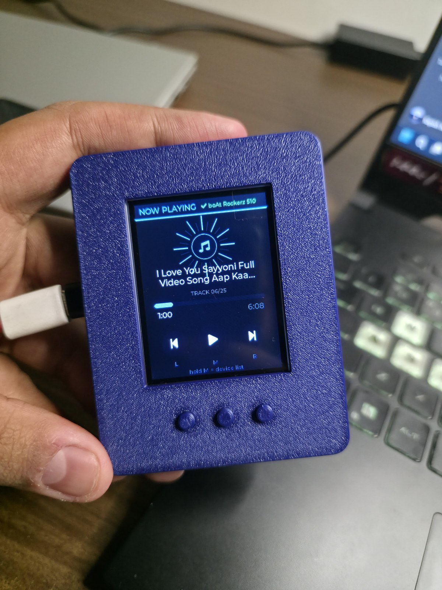

# Bluetooth MP3 Player — LilyGO TTGO T4 V1.3 (2.4" ILI9341)

PlatformIO firmware that turns the T4 V1.3 into a portable Bluetooth music
player: MP3 files from a microSD card are decoded and streamed over
Classic Bluetooth A2DP to any Bluetooth headphone or speaker you pick from
the on-screen device list.



*The finished device in its 3D-printed case, streaming to boAt Rockerz 510
headphones over Bluetooth Classic (A2DP). 3D-print files for the case will
be added to this folder soon.*

## Features

- LVGL 8 UI (240×320 portrait), light theme with a live Bluetooth status
  bar on every screen: device picker (boot default), now playing, home dashboard
- Plays .mp3 files from the microSD card (recursive scan, up to 128 tracks)
- Bluetooth A2DP **source**: boots straight into the on-screen device picker
  and the user chooses a device every time — no automatic reconnect to
  previously used devices. If the link drops, scanning restarts on its own
  and the picker refills.
- Pressing OK on the currently connected device in the picker ejects it
- Non-44.1 kHz files are resampled to 44.1 kHz stereo in real time
- Auto-next on end of track; play state survives track switching
- Volume: holding left/right changes the speaker's volume (AVRCP absolute
  volume, 10 % steps, shown on screen); a dedicated decode task feeds a PCM
  ring buffer so the Bluetooth stack is never blocked by SD/decode work
- Auto-next on end of track; play state survives track switching

## Button mapping

| Button      | Now playing             | Device picker                     | Home                  |
|-------------|-------------------------|-----------------------------------|-----------------------|
| Left (tap)  | Previous track          | Cursor **up**                     | —                     |
| Left (hold) | Volume **down**         | —                                 | —                     |
| Middle      | Play / Pause            | **OK** (connect; on the connected device = **eject**) | OK → play or picker |
| Right (tap) | Next track              | Cursor **down**                   | —                     |
| Right (hold)| Volume **up**           | —                                 | —                     |
| Middle (hold ≥250 ms) | Open device picker     | Cancel → back                    | —                     |
| BOOT        | Reload playlist from SD | —                                 | —                     |

## Hardware / pin map (T4 V1.3)

| Function                     | GPIO                 |
|------------------------------|----------------------|
| TFT ILI9341 (HSPI) MOSI/SCLK/CS/DC/RST/BL | 23 / 18 / 27 / 32 / 5 / 4 |
| microSD (VSPI) MOSI/MISO/SCK/CS | 15 / 2 / 14 / 13     |
| Buttons left / middle / right | 38 / 37 / 39 (active LOW, INPUT_PULLUP; GPIO order as wired in the printed case) |
| BOOT button                  | 0                    |

Display driver is configured entirely from `platformio.ini`
(`USER_SETUP_LOADED` + `ILI9341_DRIVER`); no global TFT_eSPI files need
editing.

## Flash it with VS Code — step by step (newcomer guide)

### 1. Install the tools (one time)

1. Install [VS Code](https://code.visualstudio.com/).
2. Open the Extensions view (`Ctrl+Shift+X`), search for **PlatformIO IDE**
   and install it. This also installs the ESP32 toolchain — it can take a
   few minutes.
3. Windows only: if no COM port shows up later, install the
   [CH9102 USB-serial driver](https://www.wch-ic.com/downloads/CH343SER_ZIP.html)
   (the T4 uses a CH9102 USB-UART chip).

### 2. Open the project

1. Download or clone this repository.
2. In VS Code: **File → Open Folder…** and select
   `T4 V1.3/Project/Bluetooth_MP3_Player` (the folder that contains
   `platformio.ini`).
3. On the first build, PlatformIO automatically downloads the ESP32
   platform and all five libraries listed in `platformio.ini`. One time
   only — after that everything is cached.

### 3. Prepare the microSD card

1. Format a microSD card as **FAT32**.
2. Copy your `.mp3` files onto it — subfolders are scanned too (up to
   128 tracks).
3. Insert the card into the T4's card slot.

### 4. Build and upload

1. Connect the T4 to the PC with a USB cable. **If a battery is attached,
   switch it off while flashing** — it interferes with the auto-reset.
2. **Build:** press `Ctrl+Alt+B` (or the ✓ button in the blue bottom bar).
   `SUCCESS` = the firmware compiled.
3. **Upload and Monitor:** click the toolbar button that shows a plug with
   an arrow (Upload and Monitor). It flashes the board and then opens the
   serial output. The first time, VS Code asks which port to use — pick the
   one shown as `USB-Enhanced-SERIAL CH9102`.
4. If the upload says `Wrong boot mode detected`: hold the board's **BOOT**
   button the moment the log shows `Connecting....` and keep holding until
   `Writing at 0x00010000` appears, then release. With the battery
   disconnected, step 3's normal flow works every time.
5. Never upload while the serial monitor is open — close it first (`Ctrl+C`
   in that terminal), or just use *Upload and Monitor*, which handles it.

### 5. Watch it boot

After upload, the serial monitor (reopen any time with `Ctrl+Alt+S`) shows:

```
[T4 MP3 1.0.0] boot
SD ok: 7580 MB
Playlist: 25 track(s)
A2DP source started
```

The screen boots straight into the Bluetooth device list and starts
scanning by itself. `Ctrl+Alt+B` / `Ctrl+Alt+U` / `Ctrl+Alt+S` are the
build / upload / monitor shortcuts.

### 6. Pair and play

1. Put your speaker or headphones in **pairing mode** (LED flashing
   red/blue) — a device that is merely switched on is invisible to the
   scan, and devices still connected to your phone/PC will not appear.
2. The device list fills by itself (the first scan can take ~30 s).
3. **Left** = move up, **right** = move down, **middle** = connect. The
   player screen appears as soon as the link is up; the full button map is
   in the table above.

### Troubleshooting

| Symptom | Fix |
|---|---|
| Upload: `Wrong boot mode detected (0xb)` | battery is powering the board — switch it off, use the BOOT-hold from step 4 |
| Upload: port doesn't exist / busy | the serial monitor is still open — close it, or use Upload and Monitor |
| No Bluetooth devices in the list | devices not in pairing mode, or still connected to your phone/PC |
| First scan takes long | normal — the Bluetooth stack waits ~10 s after power-on, each scan round is ~13 s |
| Song plays too fast or stutters | make sure you flashed the latest version of this folder (audio pipeline fixes) and re-upload |

Command-line equivalent (optional): `pio run` builds, `pio run -t upload`
flashes, `pio device monitor` opens the serial monitor. The environment is
`lilygo_t4_v13`; default upload speed 921600. The firmware uses ~1.6 MB of
flash (huge_app partition table) and builds with
`platform-espressif32@6.5.0`.

## First use

1. Format a microSD card as FAT32 and drop `.mp3` files onto it (folder
   structure is scanned recursively).
2. Insert the card and power on. The device boots **straight into the
   Bluetooth device list** — scanning starts automatically, no button press
   needed. The header shows the live link state; the list shows `found N`.
   (The first scan after power-on can take ~30 s; that delay is built into
   the Bluetooth stack.)
3. Put your Bluetooth headphones or speaker in **pairing mode** (LED
   flashing red/blue) — a device that is merely powered on is not
   discoverable.
4. Pick a device with **left = up, right = down** and press **middle** to
   connect. When the connection comes up the player screen appears
   automatically; press middle to play/pause, left/right skip tracks.
5. To switch or disconnect: hold middle to reopen the picker. OK on the
   connected device (marked with a green check) ejects it. Pressing BOOT
   rescans the SD card.

There is deliberately **no auto-reconnect**: every power-up shows the device
list and the user picks a device. If the Bluetooth link drops mid-playback,
the device list comes back on screen by itself.

## Project layout

```text
Bluetooth_MP3_Player/
├── platformio.ini          # env `lilygo_t4_v13`, TFT_eSPI setup, lib_deps
├── include/
│   ├── app_config.h        # pin map + tunables (keep this name: unique,
│   │                       # avoids clashing with ESP32-A2DP's config.h)
│   └── lv_conf.h           # LVGL 8.3 config (fonts, memory, custom tick)
├── lib/Button2/            # vendored button library (LilyGo_Txx copy)
└── src/
    ├── main.cpp            # boot sequence and main loop
    ├── engine.cpp/.h       # A2DP source engine, decode + resample pipeline
    ├── playlist.cpp/.h     # SD card MP3 scanner (storage allocated in PSRAM)
    ├── mp3_info.cpp/.h     # MP3 frame-header parse (duration, sample rate)
    └── ui.cpp/.h           # LVGL screens + Button2 handling
```

## Memory notes (important for classic BT)

The classic Bluetooth stack claims most of the free internal RAM while it
initialises — if less than ~60–80 KB of internal heap remains free at
`a2dpSource_.start()`, bluedroid's dynamic allocations return NULL and the
ESP32 panics (`StoreProhibited` inside `bta_sys_init`). That is why the
playlist storage (128 tracks × 192-char paths + 64-char titles, ~33 KB) is
allocated in **PSRAM** at scan time (falls back to internal heap on boards
without PSRAM). The build also enables `BOARD_HAS_PSRAM` with the ESP32
PSRAM cache workaround. The boot log prints `Free heap before BT:` and
`PSRAM:` — keep an eye on those if you add features.

`NVS OPEN ERROR` from `read_address()` on the very first boot is expected
and harmless: the NVS namespace for the last-paired device simply does not
exist until the first successful pairing. It disappears afterwards.

## Notes and limitations

- This board is a classic ESP32, so Bluetooth **Classic** (A2DP) is used —
  that's what gives lossless-quality streaming to headphones/speakers.
- **Audio architecture**: MP3 decoding runs in its own task (`mp3dec`,
  core 1) that fills a 16 KB internal-RAM ring buffer of decoded/resampled
  PCM; the Bluetooth stack's data callback only copies from that ring. SD
  reads and decoder work therefore can never stall the Bluetooth stack
  (which would trip the task watchdog). Decoded frame reads are capped at
  3072 bytes so libhelix's internal 8 KB result queue can never overflow.
- MP3 only (libhelix decoder); VBR and CBR both work. Track duration is
  read from Xing/Info headers when present, estimated from bitrate
  otherwise (64-bit math, so >75-minute tracks show correct durations).
- Playlist capacity is 128 tracks with full-length paths (PSRAM-backed);
  paths longer than 191 characters are skipped with a serial message.
- The backlight switches off automatically after 3 minutes without a
  button press (`LCD_AUTO_SLEEP_MS`) and wakes on the next press.
- The board's battery ADC pins (GPIO35/36) and speaker-amp pins (GPIO19/25)
  are currently unused — the firmware only streams over Bluetooth. They can
  be added later without touching the audio path.

## Sources

- [LILYGO T4 product page](https://lilygo.cc/products/t4)
- [LilyGo_Txx repository](https://github.com/Xinyuan-LilyGO/LilyGo_Txx)
  (T4_V13 pin definitions, Button2 library)
- [ESP32-A2DP](https://github.com/pschatzmann/ESP32-A2DP) and
  [arduino-audio-tools](https://github.com/pschatzmann/arduino-audio-tools)
  / [codec-helix](https://github.com/pschatzmann/codec-helix) for the
  Bluetooth source and MP3 decode pipeline
