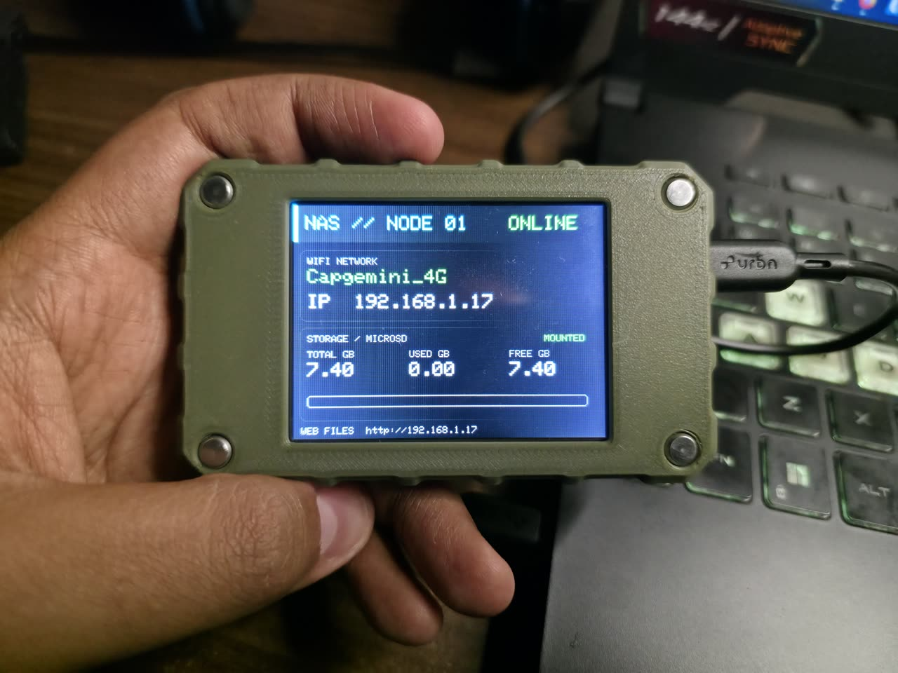
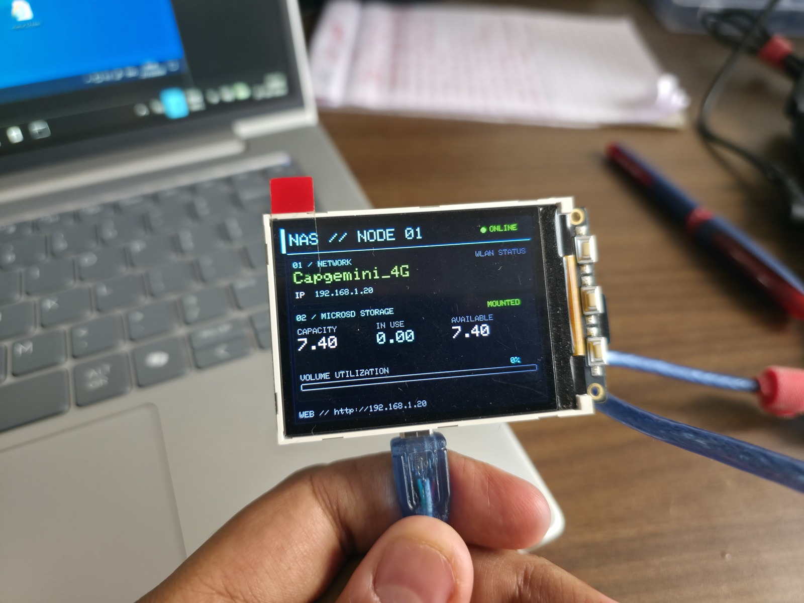

# ESP32 NAS — LILYGO TTGO T4 V1.3

PlatformIO-only port of the ESP32 NAS project for the LILYGO TTGO T4 V1.3 (2.4-inch display option). It carries over the web file manager, Wi-Fi setup portal, SD recovery, status screens, OTA, and saved Wi-Fi credentials from the Elecrow-based project while using the T4 V1.3 hardware pinout.

## Features

- Web file manager: browse, upload, download, create folders, delete files, and recursively delete folders
- Captive-style open Wi-Fi setup AP (`NAS-Setup`, `http://192.168.4.1`)
- TFT status, access point, and SD fault/recovery screens
- Wi-Fi reconnect and AP fallback
- OTA firmware updates via ArduinoOTA
- Wi-Fi credentials saved in ESP32 NVS
- Optional first-boot credentials via ignored `include/secrets.h`

## Screenshots

### Web file manager


The file manager provides a browser-based view of the microSD card, including storage usage, transfer status, and device network status. Example items shown include the `LOSTDIR` and `photos` folders, plus PDF documents such as `Custom G-Codes-for-FPS+and-P2S+Bambu+Lab+printers.pdf` and `Urvsh Nukum - 20-Aug-2026.pdf`.

### TFT status display



## Hardware / pin map

| Function | GPIO |
|---|---:|
| TFT driver / resolution | ILI9341 / 320×240 landscape |
| TFT MOSI / MISO / SCLK | 23 / 12 / 18 |
| TFT CS / DC / RESET | 27 / 32 / 5 |
| TFT backlight | 4 (active HIGH) |
| microSD MOSI / MISO / SCK / CS | 15 / 2 / 14 / 13 |

The TFT uses HSPI and the microSD card uses the separate VSPI bus. SD is initialized at a conservative 4 MHz. TFT_eSPI is configured from `PlatformIO/platformio.ini`; no edits to a global TFT_eSPI setup file are required.

> LILYGO product materials list both 2.2-inch and 2.4-inch options. The display is 320×240 in either case; this build targets the T4 V1.3 pinout documented in the vendor repository and schematic. Verify your board is T4 V1.3, not V1.2, before flashing.

## Build and upload

Install PlatformIO Core or the VS Code PlatformIO extension, then:

```sh
cd PlatformIO
pio run
pio run -t upload
pio device monitor
```

The PlatformIO environment is `lilygo_t4_v13`. Default upload speed is 921600; if uploads are unstable, lower `upload_speed` in `platformio.ini` (for example, to 460800 or 115200).

> **Final check:** the latest source tree builds successfully with PlatformIO (`pio run`). Build artifacts are not part of the source project and are regenerated on each build.

## First boot

1. Insert a FAT32-formatted microSD card and power the T4 on.
2. Connect a phone or computer to the open `NAS-Setup` Wi-Fi network.
3. Open `http://192.168.4.1`, enter home Wi-Fi details, and save.
4. After reboot, check the serial monitor or TFT for the device IP, then visit `http://<device-ip>/`.

Wi-Fi setup credentials persist in NVS. Optional first-boot defaults are already set in `PlatformIO/include/secrets.h` to the values supplied for this device. That file is ignored by git and must never be committed. To change or remove defaults, edit/delete that file or use `secrets.h.example` as a template. Saved NVS credentials take priority over the defaults.

The web UI is embedded in firmware. `index.html` at the project root is a standalone reference/sample and is not required on the SD card.

## Network security note

This firmware currently serves HTTP without user authentication, matching the supplied source project. Treat it as a trusted-LAN prototype: do not forward port 80 from your router, expose it to the public internet, or use the open setup AP in a public place. Anyone who can reach the device can read, upload, or delete SD-card files. Add authentication and secure transport before deploying where untrusted clients can connect.

## Sources

- Original NAS source project: supplied Elecrow CrowPanel ESP32 NAS PlatformIO project
- [LILYGO T4 product page](https://lilygo.cc/products/t4)
- [LILYGO T4 board repository](https://github.com/Xinyuan-LilyGO/LilyGo_Txx)
- Board configuration: `LilyGo_Txx/User_Setups/T4_V13.h` and `LilyGo_Txx/T4_V13.h`

## Project layout

```text
ESP32_NAS/
├── PlatformIO/
│   ├── platformio.ini
│   ├── include/
│   │   ├── config.h
│   │   └── secrets.h.example
│   └── src/main.cpp
├── images/
├── index.html
└── README.md
```

### Hardware photo



The photo shows the T4 running the NAS network and microSD status screen. The displayed IP address is a private LAN address and varies by network.
